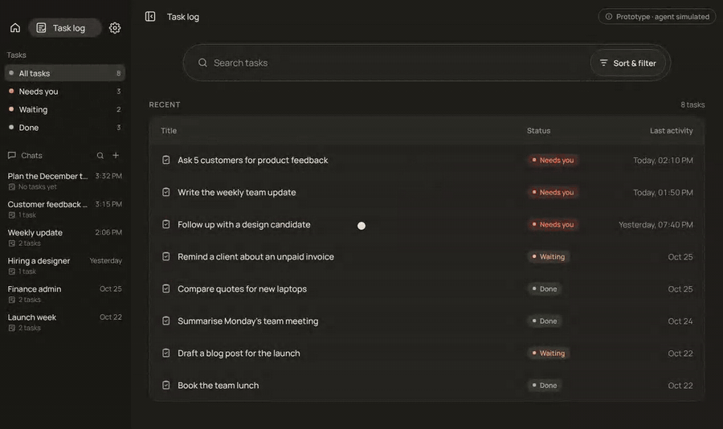

# Hyper Task Log

A clickable product concept for Hyper's task log, a place where every piece of work the agent does shows what was done, what still needs you, and lets you act on it right there.

**Try it live:** https://ofsatya.github.io/hyper-task-log/



Start with **Ask 5 customers for product feedback**: reply to Priya, review the draft, send it, and watch the task update. Then mark the remaining item handled and the task turns Done.

## What's simulated and what's designed to be real

| Simulated | Designed to be real |
| --- | --- |
| **The agent.** Its replies are built from the sample data, not from an AI model. | **The task list**, and how each status (Needs you, Waiting, Done) is worked out from what's still open. |
| **Sending.** No email or message ever leaves the page. | **The task page**: what was done, needs attention, activity, artifacts and sources. |
| **The people, replies, tools and sources.** Priya, Notion, Gmail and the rest are sample data. | **Draft, review, send**, and watching the task update. Marking an item handled. |
| | **The task chat beside each task**, and tracing any task back to the chat it came from. |

Home, Settings, chat search and new chat are outside the scope of this demo and say so when clicked. **Reset demo**, in the *Prototype · agent simulated* window, puts everything back as it was when the page opened.

## Run it on your computer

The prototype is a few plain files with no build step, but it has to be served from a local web server. Opening `index.html` by double-clicking won't work, because the browser then blocks the app from talking to the task log inside it.

With Python (usually already there on a Mac or Linux):

```bash
cd hyper-task-log
python3 -m http.server 8000
```

Then open http://localhost:8000 in your browser. Press `Ctrl+C` in the terminal to stop it.

## What's in the folder

| File | What it is |
| --- | --- |
| `index.html` | The main app: sidebar, chats, top bar and the About window. Its styles live here too. |
| `app.js` | How the main app behaves: chats, drafts, sending, Reset demo. |
| `tasklog.html` | The task log (the list and each task's page), shown inside the main app. |
| `tasklog.js` | How the task log behaves, including the simulated agent's answers. |
| `data.js` | The example data: the sample tasks and chats the demo opens with. |
| `assets/` | Tab icon, link preview image and the demo GIF. |
